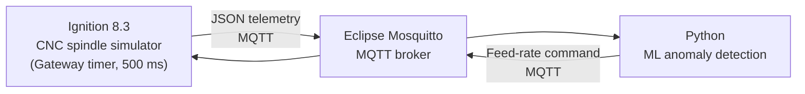

# Smart CNC Optimizer

Monitor CNC spindle telemetry, feed it to a machine learning model that watches for tool problems, and automatically adjust machining parameters to reduce damage, all in real time.

> **Status:** Simulator and telemetry pipeline complete. ML anomaly detection and closed-loop feed control in progress.

---

## Why this project

Cutting tools wear down and chatter during machining. Left unchecked, this ruins parts and breaks tools. These events show up in measurable properties of the machining process: spindle speed, motor current, coolant temperature, vibration, tool wear and feed rate.

By monitoring that data programmatically, a system can make **just-in-time adjustments** to machining parameters (like reducing the feed rate) to cut down on these unwanted events, instead of waiting for an operator to notice.

This project is a simplified, fully software-based version of that application: a simulated CNC spindle, an industrial data pipeline, and an ML model that closes the loop.

---

## Architecture



1. **Ignition** simulates the spindle physics and writes the results to tags.
2. A Gateway timer script publishes the readings as **JSON over MQTT** twice per second.
3. **Python** subscribes to the telemetry and scores each reading with an ML model *(in progress)*.
4. When a fault is detected, Python publishes a **command back to Ignition** to reduce the feed rate *(in progress)*.

**Telemetry topic:** `plant/test/cnc01/telemetry`

```json
{"machine": "CNC01", "ts": 1794692336016, "rpm": 10042.0, "current": 14.65,
 "temp": 25.46, "vibration": 0.336, "wear": 0.0, "feed_override": 100, "fault_mode": 0}
```

---

## Tech stack

| Layer | Tools |
|---|---|
| SCADA / IIoT platform | Ignition 8.3 (Maker Edition), Perspective |
| MQTT modules | Cirrus Link MQTT Transmission, MQTT Engine |
| Message broker | Eclipse Mosquitto |
| Simulation scripting | Jython 2.7 (Ignition Gateway scripts) |
| Data and ML | Python 3, paho-mqtt 2.x, pandas, NumPy, scikit-learn |
| Dev environment | Windows, PowerShell, VS Code, Git |

---

## Sensor selection and physics

### Why these four signals

Spindle speed (RPM), motor current, coolant temperature and vibration are commonly and easily measured on CNC machines. Together they're good enough to predict most tool events without exotic instrumentation.

| Signal | Unit | Healthy baseline | Why it matters |
|---|---|---|---|
| Spindle speed | RPM | 10,000 ± 50 (1σ) | Drops slightly under heavy load (speed droop) |
| Motor current | A | 14.5 ± 0.25 (1σ) | Proportional to cutting torque |
| Coolant temperature | °C | Drifts 24.0–28.5 | Shows friction heat and cooling problems |
| Vibration | g RMS | 0.35 ± 0.03 (1σ) | Most sensitive indicator of chatter and tool damage |

### Why vibration is measured in g RMS

Industry-standard vibration sensors (accelerometers) report in **g**, where 1 g = 9.81 m/s². Using g matches what a real monitoring system and its sensor datasheets would show. **RMS** (root mean square) turns the rapidly oscillating vibration signal into a single number for overall vibration energy, which is what gets trended and alarmed on.

### Simplified cutting physics

- **Current ∝ torque.** In an electric motor, torque is directly proportional to current. Anything that makes cutting harder (friction, uneven impacts) increases torque, so it shows up as higher motor current.
- **Speed droop.** Extra load torque briefly slows the spindle before the drive compensates, so RPM dips slightly under fault conditions.
- **Thermal mass.** Temperature doesn't jump instantly. Each tick, it moves 10% of the way toward its target value (a first-order lag), which mimics how coolant heats up and cools down gradually.
- **Feed rate affects severity.** All fault effects scale with the feed rate override (`k = feed / 100`). Current scales linearly with feed, since cutting force is roughly proportional to chip thickness. Chatter vibration scales with `k²`, since it grows faster than linearly. This is what lets a feed reduction visibly reduce the problem.

### Sensor noise

Healthy readings are modeled as **baseline + Gaussian (normal) noise**. Real sensor variation comes from many small independent disturbances (electrical noise, material variation, tool engagement), which together form a bell curve. Coolant temperature also follows a slow sine-wave drift (~10.5 minute period) to represent chiller cycling and ambient changes.

---

## Fault modes

Faults are selected with the `Fault_Mode` tag and can be changed live while the simulation runs.

| Code | Mode | What's simulated | Signature |
|---|---|---|---|
| 0 | **Healthy** | Brand-new tool, no issues | Baseline + noise. Tool wear held at 0. |
| 1 | **Chipped tool** | Tool has broken but is still cutting | Vibration jumps to ~2.1 g, current to ~22.5 A, small RPM drop (~80 RPM), small heat rise (+0.5 °C) |
| 2 | **Worn tool** | Tool gradually wears out over ~2 minutes | Wear ramps 0→100%. Effects grow with wear²: at full wear, current +3 A, vibration +0.6 g, temp +2 °C, RPM −30 |
| 3 | **Coolant failure** | Coolant flow is reduced or ineffective | Temperature climbs steadily (~0.1 °C/s, capped at 45 °C). Mechanical signals stay normal. |

**Chipped vs. worn:** a chipped tool is an extreme version of tool damage. Its uneven impacts have a large effect on vibration and torque (and therefore current). It produces **less** heat than a worn tool, because a worn tool rubs against the part continuously and creates more friction.

**Worn tool progression:** wear accelerates toward end of life. Effects scale with the square of wear, so the first ~40 seconds show very little change and then the effects build quickly, a simplified version of the classic tool-wear curve. Lower feed rates also slow the wear rate.

---

## Ignition tag structure

A **User Defined Type (UDT)** called `CNC_Spindle` defines the spindle object and all its tags. Each machine is an instance of the UDT, so adding a machine takes one click, and changing the template updates every instance.

```
[default]
└── TestPlant/
    └── Line1/
        └── CNC01            (instance of CNC_Spindle)
            ├── Spindle_RPM               Double   RPM   0–15000
            ├── Motor_Current_Amps        Double   A     0–30
            ├── Coolant_Temp_C            Double   °C    0–50
            ├── Vibration_RMS_g           Double   g     0–3
            ├── Tool_Wear_Pct             Double   %     0–100
            ├── Feed_Rate_Override_Pct    Integer  %     0–100
            └── Fault_Mode                Integer        0–3
```

---

## Repository layout

```
smart-cnc-optimizer/
├── ignition/
│   ├── gateway_timer.py          # Simulator: runs inside Ignition as a Gateway timer script
│   ├── cnc_spindle_udt.json      # CNC_Spindle UDT export
│   └── testplant_tags.json       # TestPlant tag folder and CNC01 instance export
├── sub_test.py                   # Connectivity test: prints every MQTT message on the broker
├── telemetry_test.py             # Prints the live JSON telemetry stream from CNC01
├── requirements.txt
└── README.md
```

ML scripts (data logger, anomaly detector, closed-loop optimizer) will be added in the next phase.

---

## Setup and running

**Prerequisites:** Ignition 8.3 (Maker Edition works), Eclipse Mosquitto, Python 3.10+.

1. **Clone the repo** and set up Python:
   ```powershell
   git clone https://github.com/njsav26/smart-cnc-optimizer.git
   cd smart-cnc-optimizer
   python -m venv venv
   .\venv\Scripts\Activate.ps1
   pip install -r requirements.txt
   ```
2. **Start Mosquitto** on `localhost:1883`.
3. **Install Ignition** and the **MQTT Transmission** and **MQTT Engine** modules. Point both modules' servers at `tcp://localhost:1883`.
4. **Enable the RPC client** for scripted publishing (see *Setup gotchas*).
5. **Import the tags:** in Designer's Tag Browser, import `ignition/cnc_spindle_udt.json` (UDT Definitions) and `ignition/testplant_tags.json` (Tags).
6. **Add the timer script:** in a Designer project, go to Scripting → Gateway Events → Timer, add a timer (500 ms, Fixed Delay, Dedicated), paste `ignition/gateway_timer.py`, and save.
7. **Run the stream monitor:**
   ```powershell
   python telemetry_test.py
   ```
   You should see two JSON messages per second.
8. **Inject a fault:** set `Fault_Mode` to 1, 2 or 3 in the Tag Browser and watch the readings change.

---

## Setup gotchas

Real problems hit while building this, and how they were fixed:

- **No output from the telemetry stream.** Python connected but no messages arrived. The Gateway logs showed `Can't RPC publish ... RPC connection is disabled for the 'Default' server set`. `system.cirruslink.transmission.publish()` uses a separate RPC client connection, which is off by default.
  **Fix:** Gateway → MQTT Transmission → Configuration → **Sets** → edit Default → enable the **RPC Client** (and Auto-reconnect), then save. *(Check you're in Transmission, not Engine. Both have a Sets tab.)*
- **Couldn't write tag values while running.** Editing `Fault_Mode` failed with `Bad_GatewayCommOff`. Designer opens in read-only communication mode by default as a safety measure.
  **Fix:** switch Designer's communication mode to **Read/Write** in the top toolbar.
- **Timer scripts in Ignition 8.3** are wrapped in `def handleTimerEvent():`, so the whole script body must be indented inside that function.

---

## Design decisions and simplifications

- **JSON instead of Sparkplug B.** MQTT Transmission normally publishes binary Sparkplug B payloads. Publishing plain JSON from a Gateway script keeps the Python side simple and readable.
- **Physics are simplified on purpose.** Fault magnitudes are chosen to be plausible and clearly visible in a demo, not derived from a detailed cutting model.
- **No wear in healthy mode.** Mode 0 represents a brand-new tool, and wear resets whenever the mode returns to 0. This keeps the healthy training data clean for the ML model, at the cost of realism (real tools wear slowly all the time).
- **Wear isn't tracked for a chipped tool.** A chipped tool gets replaced, not monitored, so tracking its wear wouldn't drive any decision.
- **Temperature is stored in its own tag** between timer runs, since Gateway timer scripts don't keep variables from one run to the next. The same approach stores tool wear.
- **Feed scaling is built into the physics** so the closed-loop feed reduction measurably reduces fault severity.

---

## Results

*Coming soon: demo video, dashboard screenshots and detection timing.*

---

## Future work

- **More realistic wear modeling:** a separate tool-change event, slow continuous wear on a new tool over a long duration, accelerating wear past a threshold, and sudden breakage at end of life.
- **Different responses per fault:** throttle the feed to extend a worn tool's life, but stop and alert the operator to replace a chipped tool.
- **Reusable, machine-agnostic code:** refactor the simulator so the same script supports different machine models and many machines (e.g. generated from a CSV equipment list).


